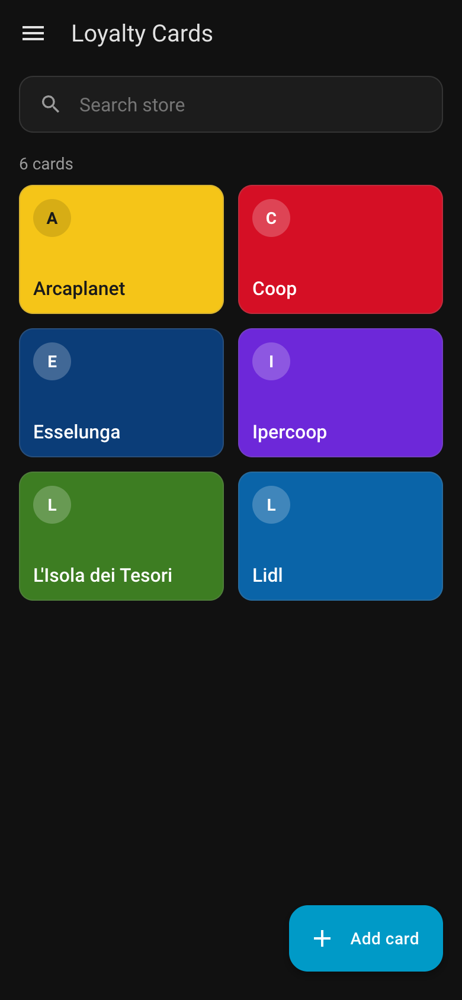
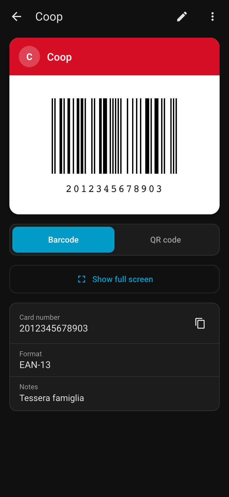
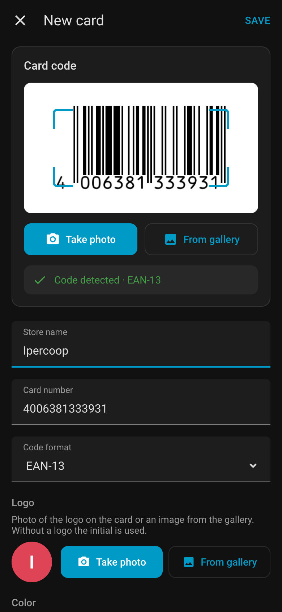
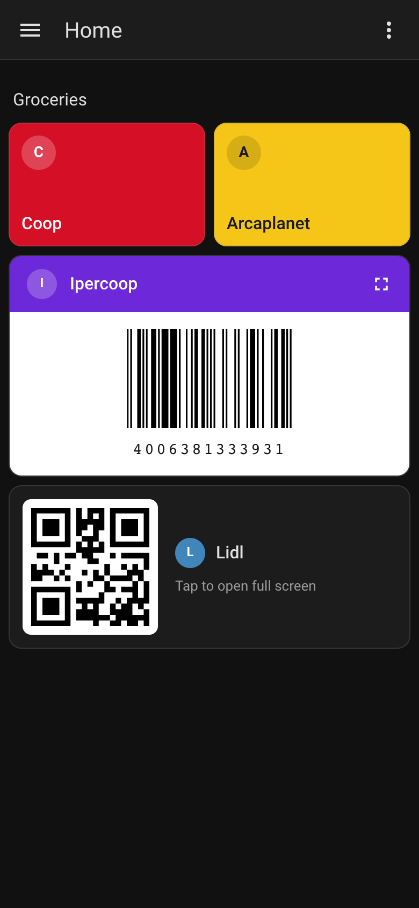

# Loyalty Cards for Home Assistant

Keep your store loyalty cards in Home Assistant and show them at the checkout from the Companion app.

- Sidebar panel with your cards as colored tiles, searchable by store name.
- Barcode or QR code ready to scan, full screen with the screen kept awake.
- Add a card by taking a photo of its barcode (or picking one from the gallery), or type the number.
- Logo, color and personal notes per card; each card can be shared with the household or private.
- Lovelace card to put a loyalty card on any dashboard.
- Translated into English, Italian, German, French, Spanish, Portuguese, Dutch and Polish.

| Cards | Card details | Add a card | Dashboard card |
| :---: | :---: | :---: | :---: |
|  |  |  |  |

Everything stays on your Home Assistant: photos are decoded in the browser and never uploaded, cards are stored in `.storage/loyalty_cards` and included in backups. No entities, sensors or services are created.

## Installation

Requires Home Assistant 2026.10 or newer.

1. In HACS open the menu ⋮ → **Custom repositories**, add `https://github.com/oirad/ha-loyalty-cards` with type **Integration**.
2. Install **Loyalty Cards** and restart Home Assistant.
3. Go to **Settings → Devices & services → Add integration** and pick **Loyalty Cards**.

The **Loyalty Cards** panel appears in the sidebar for every user.

## Supported codes

EAN-13, EAN-8, UPC-A, UPC-E, Code 128, Code 39, ITF, Codabar, QR code, Data Matrix, PDF417 and Aztec. Any card can also be shown as a QR code; if a number is not valid for its barcode format the QR code is shown instead.

Scanning uses the browser's native barcode detector where available and falls back to a bundled ZXing decoder (for example on iPhone). Blurry photos or reflections can prevent detection: the number can always be typed by hand.

## Visibility

- **Shared** (default): every Home Assistant user can see and edit the card.
- **Only me**: only the user who made the card private sees and manages it.

Private cards are hidden by the panel and the WebSocket API; they are **not encrypted**. An administrator with access to the files can read them in `.storage/loyalty_cards`.

## Dashboard card

Add **Loyalty card** from the card picker and choose the card in the visual editor, or use YAML:

```yaml
type: custom:loyalty-cards-card
card_id: 6562887d6a7d4616b2498d1be4e0f3b8
mode: tile          # tile | barcode | qr
tap_action: detail  # detail | fullscreen | none
```

The card script is loaded by the integration: there is no resource to add by hand.

## Development

```sh
# backend tests (Python 3.14)
pip install -r requirements_test.txt
pytest

# frontend
cd frontend
npm ci
npm test
npm run build   # writes custom_components/loyalty_cards/www
```

The compiled frontend in `custom_components/loyalty_cards/www` is committed, so HACS installs it straight from the release tag. Rebuild it before tagging a release; CI fails if it is out of date.

Releases: set `version` in `custom_components/loyalty_cards/manifest.json`, then publish a GitHub release whose tag matches it (e.g. `v0.1.0`).
